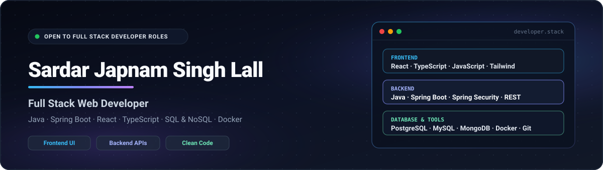
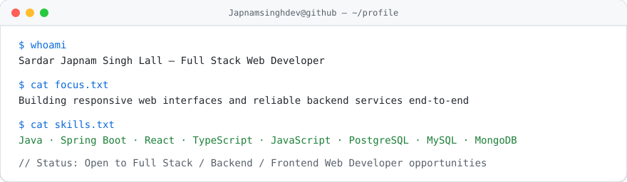

# Hi, I'm Japnam Singh

**Full Stack Java Developer** · I build scalable Spring Boot backends & React web apps · Open to opportunities

  
  
  <!-- Add your Portfolio & LinkedIn links below when ready:
  
  
  -->

### About me

<picture>
  <source media="(prefers-color-scheme: dark)" srcset="assets/terminal-dark.svg">
  
</picture>

- I build **end-to-end full-stack web applications** using **Java 21, Spring Boot & React (TypeScript)**
- Right now I'm building **ShopSphere** — a multi-vendor e-commerce platform with **PostgreSQL, Redis & Apache Kafka**
- Ask me about **Java, Spring Boot, Spring Security (JWT), REST APIs, PostgreSQL & React**

### Things I'm building

<table>
  <tr>
    <td width="50%" valign="top">
      <h4>ShopSphere <i>(In Progress)</i></h4>
      Multi-vendor e-commerce platform with JWT refresh-token rotation, Flyway PostgreSQL migrations, Redis caching, Kafka notifications, and a React + TypeScript storefront.  
      
      
      
      
    </td>
    <td width="50%" valign="top">
      <h4>More Projects Coming Soon</h4>
      Publishing clean, well-documented full-stack Java &amp; React projects here — each with architecture notes, screenshots, and local run steps.  
      
      
      
    </td>
  </tr>
</table>

### Tech stack

   
   
  

  
  
  
  

### GitHub activity

  <picture>
    <source media="(prefers-color-scheme: dark)" srcset="https://streak-stats.demolab.com/?user=lucky638718&theme=github-dark-blue&hide_border=true&background=0d1117">
    
  </picture>

<picture>
  <source media="(prefers-color-scheme: dark)" srcset="https://github-readme-activity-graph.vercel.app/graph?username=lucky638718&bg_color=0d1117&color=8b949e&line=36bcf7&point=a371f7&area=true&area_color=36bcf7&hide_border=true">
  
</picture>

  

